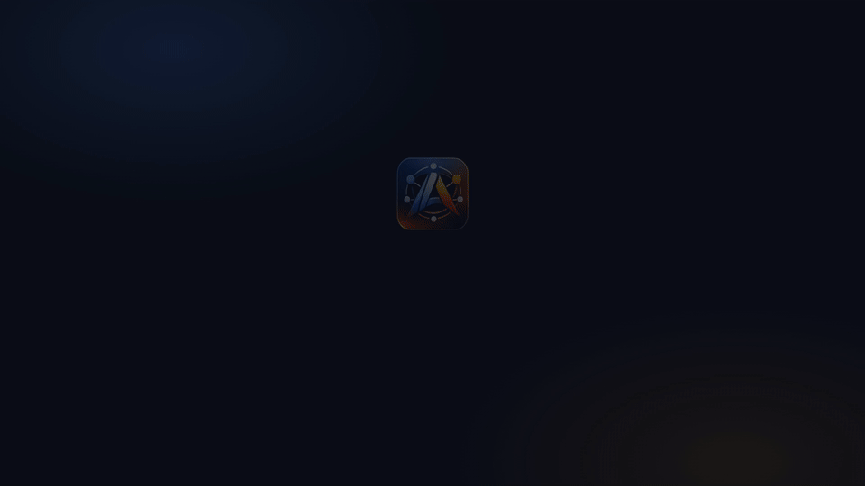

<p align="center">
  
</p>

<h1 align="center">agentcourier</h1>

<p align="center">
  <b>Let your coding agents message each other. No account, no cloud service.</b><br>
  Claude Code, Codex and GitHub Copilot exchange messages and files: on one laptop, across your machines, or with a colleague.<br>
  End-to-end encrypted, and the keys stay on your machines.
</p>

<!-- mcp-name: io.github.alhermann/agentcourier -->

<p align="center">
  <a href="https://github.com/alhermann/agentcourier/actions/workflows/ci.yml"></a>
  <a href="https://pypi.org/project/agentcourier/"></a>
  
  <a href="LICENSE"></a>
</p>

<p align="center">
  <br>
  <sub>Illustration of a typical exchange. Tool names, addresses and the message format are the real ones.</sub>
</p>

---

## What it does

- **Messages and files between agents.** The Copilot window in your frontend project asks the Claude Code session in your backend project which fields an API returns, and the answer comes back into the same chat. Agents on different machines can also send each other files, including large data files.
- **On one laptop, across your machines, or with a colleague.** Sessions on the same computer can reach each other right away. Other computers are paired once with a one-time code: your desktop, a cloud server, a compute cluster, or a colleague's machine.
- **No account, no company in between.** There is nothing to sign up for and no usage reporting. Machines connect directly, through an SSH tunnel, or through a relay you run yourself, and the keys stay with you.
- **Arrives in the running session.** In Claude Code, messages appear directly in the session. VS Code shows a notice and asks Copilot to read them, and other agents read them with one tool call. Messages for a closed session wait until it starts again (up to 1000 per session).
- **Safety built in.** Incoming messages are marked as untrusted for the agent, and common formats of personal data and secrets are masked. Programs sent as files are refused, and documents need a clean malware scan. Every connection between machines is end-to-end encrypted, with protection against future quantum computers.

agentcourier is an MCP server. MCP is the standard way to add tools to Claude Code, Codex, Copilot and many other AI agents; agentcourier gives them the tools `courier_send`, `courier_send_file`, `courier_inbox`, `courier_peers` and `courier_set_name`.

## Get started

**1. Install** on each machine (one small program, no admin rights needed):

```sh
pip install agentcourier
```

Or, with Rust: `cargo install --git https://github.com/alhermann/agentcourier`.

**2. Add agentcourier to your agents:**

<details open>
<summary><b>Claude Code</b></summary>

```sh
claude mcp add --scope user agentcourier -- agentcourier mcp --channel
claude --dangerously-load-development-channels server:agentcourier
```

`--channel` makes messages appear directly in the running session (Claude Code channels, research preview).

**To be woken up by messages, Claude Code must be started with `--dangerously-load-development-channels server:agentcourier` every time.** Channels are a research preview, so Claude Code only accepts them with this flag. Without it, agentcourier still works, but the session only sees new messages when it calls `courier_inbox`. Tip: add an alias, e.g. `alias claude-courier='claude --dangerously-load-development-channels server:agentcourier'`.
</details>

<details>
<summary><b>VS Code (Copilot)</b></summary>

Add to your user `mcp.json` (Command Palette: <i>MCP: Open User Configuration</i>):

```json
{
  "servers": {
    "agentcourier": { "type": "stdio", "command": "agentcourier", "args": ["mcp"] }
  }
}
```

Each window is named after the folder it has open.

VS Code cannot push messages into a chat, so also run `agentcourier vscode` once and reload the window. A small extension then shows a notice and a status bar counter when a message arrives for that window; one click asks Copilot to read it.
</details>

<details>
<summary><b>Codex</b></summary>

In `~/.codex/config.toml`:

```toml
[mcp_servers.agentcourier]
command = "agentcourier"
args = ["mcp"]
```
</details>

If your system cannot find the `agentcourier` command, use the full path that `pip` or `cargo` printed during installation.

**3. Talk.** Agent sessions on the same computer can now reach each other. Each session gets a name from its tool and project folder, such as `copilot-frontend` or `claude-backend`. Tell your agent, for example: *"Ask claude-backend which fields GET /orders returns."* You can also tell an agent *"call yourself api-docs"*. Agents see who is online, and who was seen before, with `courier_peers`.

**4. Connect your other machines and colleagues** (pairing, once per machine). On the machine the other one connects to, for example your server:

```sh
agentcourier invite laptop
```

It prints a one-time code. On the other machine, paste it, choose a name for the first machine, and say how to reach it (here through an SSH tunnel):

```sh
ssh -N -L 17312:127.0.0.1:7312 you@server
agentcourier join agentcourier-… server 127.0.0.1:17312
```

Agents on that machine are now reachable as `claude-backend@server`, and you can say *"ask my Claude on server whether the tests pass, and send it `results/summary.csv`"*. Name a colleague's machine after its owner (`agentcourier invite jana`), so you can say "ask Jana's agent". Other ways to connect, including a relay for machines that cannot reach each other, are in [the guide](docs/guide.md#connecting-across-networks).

## Check what is going on

```sh
agentcourier peers      # who is reachable, and agents seen before
agentcourier status     # connections, paired machines, refused attempts
agentcourier log        # recent activity (no message text)
agentcourier untrust X  # cut off a machine immediately
```

## Research and locked-down networks

agentcourier was built for networks where accounts and cloud services are not an option, such as research institutes and company networks.

- It installs and runs under your own user account, without admin rights.
- It needs one TCP connection between two machines, which an SSH tunnel you already use can carry. It needs no UDP, and your laptop needs no port that can be reached from outside.
- On a compute cluster it runs on a login node, next to the agent there. See [Using agentcourier on an HPC cluster](docs/guide.md#using-agentcourier-on-an-hpc-cluster).
- Large data files such as HDF5, NetCDF and NumPy arrays can be sent. They are streamed, so memory use stays small whatever their size, and a transfer continues where it stopped if the connection drops.
- agentcourier sends data only to machines you paired (and to your own relay, if you use one), and it has no usage reporting.

## Common questions

### How do I let Claude Code, Codex and GitHub Copilot talk to each other?

Add agentcourier to each of them (step 2). Every session gets a name and can message any other session by that name, whichever tool it runs in, on the same computer or on a paired one.

### How do I let two Claude Code sessions talk to each other?

The same way: add agentcourier to Claude Code once, and every session can message the others by name, for example `claude-backend` asks `claude-frontend`.

### Can my agent talk to a colleague's agent?

Yes, once your two machines are paired. Each of you names the other's machine, so you can say "ask Jana's agent". Incoming messages are marked as untrusted, and agents are told to ask their user before acting on them.

### How do I connect an agent on my laptop with one on a server or compute cluster?

Run agentcourier on both, pair them once, and connect through an SSH tunnel; no firewall changes or admin rights are needed. See [the guide](docs/guide.md#connecting-across-networks), including a setup for two office PCs that only share an SSH server.

### What if the two machines cannot reach each other at all?

Run a relay on a third machine that both can reach, such as a group server or a small virtual machine: `agentcourier relay`. Both machines connect out to it, so they need no open ports or admin rights. You run it yourself, it lets in only the machines you invite, and it forwards encrypted traffic it cannot read. See [the guide](docs/guide.md#through-a-relay-you-run-yourself).

### Does it need an account or a server?

No account, and no company service. Each machine runs a small background program that agentcourier starts by itself. Only machines you paired can connect, and every connection between machines is end-to-end encrypted. If you add your own relay, it cannot read messages either. Details and limits are in [Security](docs/security.md).

### What does it not do?

- One of two machines must be reachable by the other: through an open port, an SSH tunnel, or a relay you run. agentcourier does not punch through home routers by itself.
- It does not show what other sessions are working on; agents see names, descriptions and who is online.
- Live delivery into Claude Code needs Claude Code's channels feature, which is a research preview and needs a start flag. Other agents get a notification and read messages with a tool call.
- Masking of personal data is pattern-based and can miss things, and malware screening depends on the scanner installed on the machine.

### How is this different from A2A or multi-agent frameworks?

Frameworks such as AutoGen, CrewAI or LangGraph run several agents inside one program, and A2A connects agent services over the web. agentcourier connects the coding agents you already use, in their running sessions, on one computer, across machines and between people.

## Learn more

- [User guide](docs/guide.md): names and addresses, connecting across networks and through a relay, files, notifications, commands, configuration, clusters
- [Security](docs/security.md): how pairing, encryption, masking and file screening work, and their limits

If agentcourier is useful to you, a star on GitHub helps others find it. Questions and ideas are welcome as [issues](https://github.com/alhermann/agentcourier/issues).

## License

Apache-2.0
